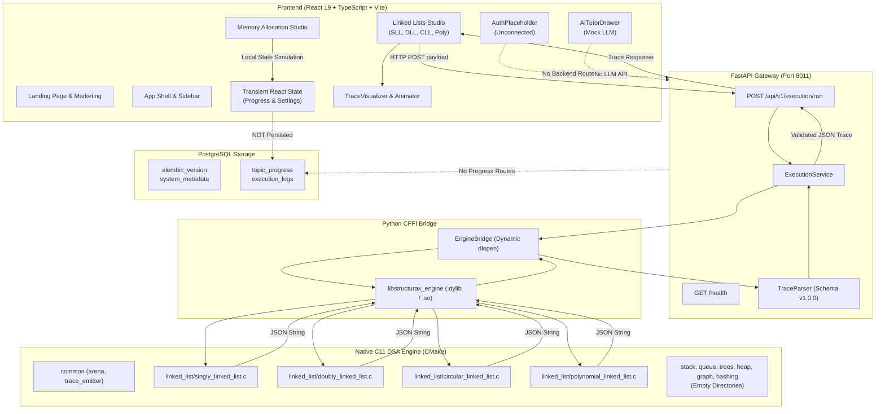

# StructuraX — Phase 0: Complete Project Audit & Redesign Planning

**Document Version:** 1.0.0  
**Audit Date:** November 2026  
**Project Path:** `/Users/sujalchavan/Documents/StructureX`  
**Status:** Pre-Phase 1 Discovery & Architectural Assessment (STRICTLY READ-ONLY)

---

## 1. Executive Summary

StructuraX is an animation-first Data Structures & Algorithms (DSA) learning platform designed to bridge low-level systems programming in C with interactive, high-fidelity frontend animations. The platform's core technical achievement is its native pipeline:
$$\text{React 19 + TypeScript} \xrightarrow{\text{JSON API}} \text{FastAPI} \xrightarrow{\text{Python CFFI}} \text{Native C11 Engine} \xrightarrow{\text{Execution Trace (JSON)}} \text{Framer Motion / SVG Visualizer}$$

### Current Strengths
1. **True Native C Execution:** Unlike typical educational platforms that run simulated or mock JavaScript algorithms, StructuraX compiles real C11 source code to a dynamic library (`libstructurax_engine.dylib` on macOS / `.so` on Linux) and produces deterministic step-by-step memory and pointer mutation events.
2. **Deterministic Step-by-Step Traces:** Every pointer change, memory allocation (`malloc`), deallocation (`free`), and node comparison is recorded with exact monotonic indices, variable bindings, and descriptive commentary.
3. **Comprehensive Unit I Foundation:** Memory Allocation (Stack vs. Heap, 8 lessons, 4 bug labs) and Linked Lists (Singly, Doubly, Circular, Polynomial) are fully implemented in the C engine and visualized with live CFFI integration.
4. **100% Test Pass Rate Across 4 Test Layers:** C engine tests (5/5), Python backend tests (14/14), frontend unit tests (7/7), and Playwright end-to-end tests (11/11) all pass with zero failures.

### Why a Phase 1 Redesign is Essential
Despite these engineering foundations, the platform suffers from significant architectural and UX bottlenecks:
- **Card-Bound Dashboard vs. Immersive Studio:** Workspaces are currently enclosed in conventional administrative dashboard cards (`AppShell.tsx`), constraining the visualizer canvas to a small portion of the screen rather than providing an expansive, professional IDE/Studio workspace.
- **Visual Design Identity Divergence:** The current color scheme is Style 5 (Navy/Blue/Indigo with `--background: #090d18` and `--primary: #4385ff`). The requested target identity is **Midnight Graphite — Premium Motion UI** (`#080D16` canvas, `#0D1421` sidebar, `#131D2D` panels, `#568BFF` accent, `#43C8E8` motion highlight).
- **Frontend/Database Disconnection:** PostgreSQL migrations and SQLAlchemy models exist for `TopicProgress` and `ExecutionLog`, but **no repository, service, or API endpoints exist** to query or persist them. All user progress in the frontend is stored in transient React component state.
- **Placeholder Facades:** Authentication (`AuthPlaceholder.tsx`) and the AI Tutor (`AiTutorDrawer.tsx`) are static UI mockups with no backend services, databases, or LLM integrations.
- **Frontend Code Sprawl:** Dead code files (`Placeholders.tsx`), duplicate navigation maps (`AppShell.tsx` vs `navigation.tsx`), unreferenced primitives (`primitives.tsx`), and a monolithic 792 kB production JS chunk require cleanup and code-splitting.

---

## 2. Existing Project Architecture

The current system runtime topology spans five distinct layers:



---

## 3. Frontend Audit

### File Structure & Pages
- **Path:** `/Users/sujalchavan/Documents/StructureX/frontend/src/`
- **Build Tool:** Vite 8.3.8, React 19, Tailwind CSS 4, Framer Motion, Lucide React, Vitest, Playwright.
- **Bundle Metrics:**
  - Production JS: `dist/assets/index-B98PJeLL.js` — **792.26 kB (gzip: 227.16 kB)** (Vite warns chunk > 500 kB).
  - Production CSS: `dist/assets/index-ivO9nbDb.css` — **99.63 kB (gzip: 17.20 kB)**.

### Detailed Page Assessment
| Page / Component | Route | Status | Functionality & Audit Findings |
| :--- | :--- | :--- | :--- |
| **LandingPage** | `/` | Complete | High visual polish. Hero visualizer, features, curriculum preview, trust metrics, responsive mobile nav. Uses Style 5 palette rather than Midnight Graphite. |
| **AppShell** | Layout | Working | Provides top navbar and sidebar navigation. Constrains main content to standard dashboard padding, giving it an admin-panel look rather than a full-bleed studio canvas. |
| **LinkedListsWorkspace** | `/learn/linked-lists` | Complete & Connected | Supports Singly, Doubly, Circular, and Polynomial lists. Full execution control (play/pause, step forward/backward, speed slider), pointer inspector, code sync, and CFFI execution. |
| **MemoryAllocationWorkspace** | `/learn/memory-allocation` | Complete (Local) | Implements 8 sequenced lessons, dual view (Beginner vs Technical C), Stack vs Heap memory grid, and 4 interactive bug labs (Leaks, Use-after-free, Double-free, Buffer overflow). Fully in-memory React simulation. |
| **CurriculumPage** | `/curriculum` | Partial | Displays curriculum cards for Units I–VI. Unit I correctly routes to live workspaces; Units II–VI route to `CurriculumPlaceholder`. |
| **Dashboard** | `/dashboard` | Partial / Stub | Renders static stats (topics completed, streak, time spent) and hardcoded recent activity. Not connected to database. |
| **DesignSystemPage** | `/design-system` | Working | Interactive showcase of buttons, inputs, badges, color palettes, and animation tokens. |
| **AiTutorDrawer** | In-workspace drawer | Stub | Simulated conversational drawer with canned responses and suggestions. No real LLM API or streaming backend. |
| **AuthPlaceholder** | `/auth/*` | Stub | Static card indicating authentication is under construction. No login, signup, or session handling. |

### Dead Code & Redundancy
1. `src/pages/Placeholders.tsx` (116 lines): Completely unused. Contains stale mock placeholders for Stack, Queue, Trees, Graph, Hashing. Replaced by `CurriculumPlaceholder.tsx` and `LearningPlaceholder.tsx`.
2. `src/data/navigation.tsx`: Defines `NAV_ITEMS` and `CURRICULUM_MODULES`, but `AppShell.tsx` re-declares its own sidebar navigation array locally, leaving `navigation.tsx` referenced only by `DesignSystemPage.tsx`.
3. `src/components/visualizer/primitives.tsx`: Contains legacy visualizer nodes (`VisualizerNode`, `VisualizerPointer`), but the actual live linked-list workspace uses `TraceVisualizer.tsx` and `canvas.tsx`.
4. Monolithic Single Chunk: All routes and modules are imported statically into `App.tsx`, causing a monolithic 792 kB initial load.

---

## 4. Backend Audit

### Structure & Framework
- **Framework:** FastAPI 0.115+ running on Python 3.12 (uvicorn port 8011).
- **Core Endpoints:**
  - `GET /health`: Inspects database connectivity, CFFI bridge availability, engine build timestamp, and memory health.
  - `POST /api/v1/execution/run`: Receives `{ structure_type, operation, params, initial_state }`, validates inputs, dispatches to C engine via CFFI, parses trace JSON, and returns `{ success, structure_type, operation, execution_time_ms, trace, final_state }`.
- **Validation & Error Handling:**
  - Strong Pydantic models in `backend/app/schemas/execution.py`.
  - Comprehensive custom exceptions in `backend/app/core/errors.py` (CFFIBridgeError, EngineExecutionError, TraceParseError).
  - Trace validation enforces monotonicity, step indices, and schema version `1.0.0`.

### Backend Deficiencies & Missing Capabilities
1. **Zero User Management & Auth Endpoints:** No endpoints exist for `/api/v1/auth/login`, `/signup`, `/me`, or `/refresh`. No JWT or session cookies.
2. **Missing Progress Endpoints:** No endpoints exist for `/api/v1/progress/topic`, `/curriculum/status`, or `/progress/streak`.
3. **Missing AI Tutor Proxy:** No `/api/v1/ai/explain` or `/api/v1/ai/tutor` endpoint exists to securely proxy LLM requests with user context and execution traces.
4. **Execution Request Timeout Handling:** C execution is currently synchronous on the worker thread. While C algorithms run in under 2 ms, an accidental infinite loop in a future C algorithm would block the Python thread. A watchdog/timeout wrapper is recommended for complex algorithms.

---

## 5. Database Audit

### Schema & Migrations
- **Engine:** PostgreSQL 16 via SQLAlchemy 2.0 and Alembic.
- **Migration History (`backend/alembic/versions/`):**
  - `0001_initial_schema.py`: Creates `system_metadata` table (`key`, `value`, `updated_at`).
  - `0002_learning_progress.py`: Creates:
    - `topic_progress` (`id`, `user_id`, `topic_id`, `status`, `score`, `completion_percentage`, `last_attempted_at`, `completed_at`).
    - `execution_logs` (`id`, `topic_id`, `structure_type`, `operation`, `status`, `duration_ms`, `created_at`).

### Database Deficiencies & Gaps
1. **Empty Directory Structure:** The root `/database` directory contains three empty folders:
   - `database/documentation/` (empty)
   - `database/schema/` (empty)
   - `database/seeds/` (empty)
   Database migrations are hosted solely in `backend/alembic/`.
2. **Missing User Entity:** Neither SQLAlchemy models nor Alembic migrations define a `users` table. The `user_id` column on `topic_progress` is an unconstrained string (`nullable=True`) with no foreign key relationship.
3. **No Database Repositories or Services:** In `backend/app/`, there are no repository classes or query functions that perform `SELECT` or `INSERT` on `TopicProgress` or `ExecutionLog`. The tables sit completely idle.

---

## 6. C Engine Audit

### Structure & Build System
- **Language Standard:** C11 (`-std=c11 -Wall -Wextra -Wpedantic -Werror -fPIC`).
- **Build System:** CMake 3.20+ generating `libstructurax_engine.dylib` (macOS) / `.so` (Linux).
- **Core Files:**
  - `dsa-engine/include/structurax_engine.h`: Public API, dynamic symbol exports (`STRUCTURAX_API`), operation codes (`SLL_OP_*`, `DLL_OP_*`, `CLL_OP_*`, `POLY_OP_*`), and unified execution entrypoints.
  - `dsa-engine/include/singly_linked_list.h`, `doubly_linked_list.h`, `circular_linked_list.h`, `polynomial_linked_list.h`.
  - `dsa-engine/src/common/arena.c`: Linear memory arena allocator with reset capabilities.
  - `dsa-engine/src/common/trace_emitter.c`: Structured JSON trace generator emitting schema-compliant events.

### Implemented vs. Missing C Engine Modules
| Module | Implementation File | Status | Unit Tests | Operations Implemented |
| :--- | :--- | :--- | :--- | :--- |
| **Singly Linked List** | `src/linked_list/singly_linked_list.c` | Complete | 11 tests | 13 operations (insert/delete variants, search, reverse, sort, cycle detection/removal, dedup) |
| **Doubly Linked List** | `src/linked_list/doubly_linked_list.c` | Complete | 8 tests | 16 operations (front/back/at insert & delete, bidirectional traversal, reverse, sort) |
| **Circular Linked List** | `src/linked_list/circular_linked_list.c` | Complete | 8 tests | 12 operations (front/back/at insert & delete, split, loop check, traversal) |
| **Polynomial List** | `src/linked_list/polynomial_linked_list.c` | Complete | 7 tests | 5 operations (create term, add polynomials, multiply, evaluate, display) |
| **Stack** | `src/stack/` | **Empty** | None | Directory empty (0 files) |
| **Queue** | `src/queue/` | **Empty** | None | Directory empty (0 files) |
| **Trees** | `src/trees/` | **Empty** | None | Directory empty (0 files) |
| **Heap** | `src/heap/` | **Empty** | None | Directory empty (0 files) |
| **Graph** | `src/graph/` | **Empty** | None | Directory empty (0 files) |
| **Hashing** | `src/hashing/` | **Empty** | None | Directory empty (0 files) |

### Memory Safety & Code Quality
- Allocation is strictly tracked. All dynamically formatted JSON strings are released via `structurax_free_string()`.
- CTest suite executes 5 independent suites (`engine_tests`, `sll_tests`, `dll_tests`, `cll_tests`, `poly_tests`) in 0.04s with zero memory leaks.

---

## 7. CFFI & Execution Trace Audit

### Bridge Implementation
- **File:** `backend/app/cffi_bridge/engine.py`
- Uses `cffi.FFI()` in `dlopen()` mode.
- Dynamically resolves library paths across:
  - Explicit environment variable `STRUCTURAX_ENGINE_LIB`
  - Relative build paths: `dsa-engine/build/libstructurax_engine.*`
  - Fallback locations: `/usr/local/lib`, `/opt/homebrew/lib`

### Execution Trace Schema (v1.0.0)
The C engine emits JSON traces parsed by `backend/app/trace_parser/parser.py`:
```json
{
  "schema_version": "1.0.0",
  "structure_type": "singly_linked_list",
  "operation": "insert_back",
  "total_steps": 4,
  "events": [
    {
      "step": 0,
      "event_type": "allocate_node",
      "description": "Allocated memory for new node with value 42 at address 0x7fa1b0",
      "pointers": { "head": "0x7fa100", "curr": null, "new_node": "0x7fa1b0" },
      "nodes": [{ "id": "0x7fa1b0", "value": 42, "next": null }],
      "code_line": 12,
      "state_snapshot": { "length": 3, "is_empty": false }
    }
  ]
}
```
TraceParser rigorously verifies:
1. `schema_version` matches supported versions.
2. Step counters are strictly monotonic ($0, 1, 2, \dots, N-1$).
3. All pointer references point to valid node IDs or `null`.

---

## 8. Memory Allocation Module Audit

The Memory Allocation topic in `MemoryAllocationWorkspace.tsx` is an educational triumph, structured into two complementary views:

### Pedagogical Structure
1. **Beginner View:**
   - Lesson 1: What is Computer Memory? (Addresses, bytes, variable labels)
   - Lesson 2: The Two Kingdoms: Stack vs Heap (Automatic stack frames vs deliberate heap allocations)
   - Lesson 3: The `malloc()` Magic Wand (Requesting heap space, void pointers, casting)
   - Lesson 4: The Clean-up Crew: `free()` (Returning heap memory, OS reclamation)
   - Lesson 5: The Deadly Memory Leak (Orphaned pointers, browser/server crashes)
   - Lesson 6: The Ghost Pointer (Dangling pointer, use-after-free dangers)
   - Lesson 7: The Double Trouble (Double-free vulnerabilities and heap corruption)
   - Lesson 8: Boundary Crash (Buffer overflows, out-of-bounds writes)
2. **Technical C View:**
   - Displays real C pointer declarations (`int *ptr = (int*)malloc(sizeof(int));`), byte arithmetic, hexadecimal memory addresses, and heap metadata overhead.
3. **Interactive Lab Arenas:**
   - **Stack vs Heap Simulator:** Visual representation of stack frames growing downward and heap allocations placed via simulated memory blocks.
   - **Interactive Bug Labs:** 4 guided debugging scenarios with immediate visual feedback:
     - Lab 1: Fix Memory Leak (Inject missing `free()`)
     - Lab 2: Neutralize Dangling Pointer (Set pointer to `NULL` after `free()`)
     - Lab 3: Prevent Double-Free (Add pointer validity check)
     - Lab 4: Catch Buffer Overflow (Enforce bounds checking on array write)

### Audit Evaluation
- **Pros:** Conceptually crystal clear, safe, visually responsive, eliminates beginner intimidation.
- **Improvement Needed:** Runs purely in local React state without persisting lab completion or quiz scores to the backend database.

---

## 9. Singly Linked List Audit

### Supported Operations
All 13 standard operations are compiled into the native C engine and verified:
1. `insert_front` ($O(1)$)
2. `insert_back` ($O(n)$ without tail pointer)
3. `insert_at` ($O(n)$)
4. `delete_front` ($O(1)$)
5. `delete_back` ($O(n)$)
6. `delete_at` ($O(n)$)
7. `delete_value` ($O(n)$)
8. `search` ($O(n)$ with traversal highlight)
9. `reverse` ($O(n)$ with 3-pointer slide: `prev`, `curr`, `next`)
10. `sort` ($O(n \log n)$ merge sort on nodes)
11. `detect_cycle` (Floyd's Tortoise and Hare algorithm)
12. `remove_cycle` (Cycle break at loop origin)
13. `remove_duplicates` (Sorted / hash deduplication)

*Note on `count`:* Count is tracked in $O(1)$ time in the `state_snapshot.length` field across all trace events, avoiding redundant traversal.

---

## 10. Doubly Linked List Audit

### Supported Operations
The DLL engine in `doubly_linked_list.c` manages dual pointers (`prev` and `next`) with full edge-case protection:
- `insert_front`, `insert_back`, `insert_at`
- `delete_front`, `delete_back`, `delete_at`, `delete_value`
- `search_forward`, `search_backward`
- `reverse` (Swapping `prev` and `next` pointers for all nodes)
- Integrity checks verifying that `node->next->prev == node`.

### Frontend Visualization
- Nodes render with dual pointer hooks.
- Color-coded pointer lines distinguish next pointers (Cyan) from previous pointers (Purple/Indigo).

---

## 11. Circular Linked List & Polynomial Audit

### Circular Linked List
- Implementation in `circular_linked_list.c`.
- Tail node's `next` pointer references `head` instead of `NULL`.
- Supports insertion, deletion, searching with cycle guard, and `split_halves` (splitting one circular list into two circular lists).
- Visualizer renders an SVG curved return path from the final node back to the head node.

### Polynomial Linked List
- Implementation in `polynomial_linked_list.c`.
- Each node stores `coefficient` (float/int), `exponent` (int), and `next`.
- Operations:
  - Create/Insert Term (maintains descending order of exponents)
  - Add Polynomials ($P_1(x) + P_2(x)$)
  - Multiply Polynomials ($P_1(x) \times P_2(x)$)
  - Evaluate Polynomial for a given $x$ ($P(x_0)$)
- Visualizer renders standard algebraic notation ($4x^3 - 2x + 7$).

---

## 12. Animation and Interaction Audit

### Current Motion Stack
- **Libraries:** Framer Motion 12.4+ and HTML5 SVG rendering.
- **Capabilities:**
  - Node layout animation via `layoutId` ensuring smooth positional transitions during insertions and deletions.
  - Variable speed playback slider ($0.25\times, 0.5\times, 1\times, 1.5\times, 2\times$).
  - Step forward, step backward, play/pause, and jump to start/end controls.
  - Active pointer highlights (`head`, `tail`, `curr`, `temp`, `prev`).
  - Active code line synchronization in the side panel.

### Bottlenecks & UX Issues
1. **Container Confinement:** The visualizer is constrained within a standard card layout in `AppShell`, causing horizontal scrolling on lists longer than 6 nodes.
2. **Layout Shifts:** When node values change size (e.g. 1 digit to 4 digits), neighboring nodes experience abrupt layout reflows.
3. **SVG Connection Occlusion:** In Circular Linked Lists, the return loop SVG line occasionally clips through node boundaries on responsive viewport resizing.

---

## 13. Curriculum Completeness Matrix

| Unit | Topic Name | C Engine Implementation | Backend CFFI Route | Frontend Workspace | E2E Tests | Overall Status |
| :---: | :--- | :---: | :---: | :---: | :---: | :---: |
| **Unit I** | Static vs Dynamic Memory | N/A (Emulated) | Local State | Complete (8 lessons, 4 labs) | Pass | **Production Ready** |
| **Unit I** | Singly Linked Lists | Complete (13 ops) | Active | Complete (Trace Visualizer) | Pass | **Production Ready** |
| **Unit I** | Doubly Linked Lists | Complete (16 ops) | Active | Complete (Dual Pointers) | Pass | **Production Ready** |
| **Unit I** | Circular Linked Lists | Complete (12 ops) | Active | Complete (Loop SVG) | Pass | **Production Ready** |
| **Unit I** | Polynomial Representation | Complete (5 ops) | Active | Complete (Math notation) | Pass | **Production Ready** |
| **Unit II** | Stacks (Array & Linked List) | Empty (0%) | Missing | Placeholder UI | None | **Missing** |
| **Unit II** | Queues (Circular & Deque) | Empty (0%) | Missing | Placeholder UI | None | **Missing** |
| **Unit III** | Trees & Binary Search Trees | Empty (0%) | Missing | Placeholder UI | None | **Missing** |
| **Unit III** | AVL Trees & Traversals | Empty (0%) | Missing | Placeholder UI | None | **Missing** |
| **Unit IV** | Heaps & Priority Queues | Empty (0%) | Missing | Placeholder UI | None | **Missing** |
| **Unit V** | Graphs & Shortest Path | Empty (0%) | Missing | Placeholder UI | None | **Missing** |
| **Unit VI** | Hashing & Collision Handling | Empty (0%) | Missing | Placeholder UI | None | **Missing** |

---

## 14. Test Results

### Test Execution Summary (Live Verification Run)
All four test suites were executed sequentially during this audit:

```
1. C Engine Unit Tests (CTest)
   - Total Suites: 5 (engine_tests, sll_tests, dll_tests, cll_tests, poly_tests)
   - Results: 5 / 5 PASSED (100%)
   - Execution Time: 0.04s

2. Backend Unit & Integration Tests (pytest)
   - Total Tests: 14 (test_engine_bridge, test_execution, test_health, test_trace_parser)
   - Results: 14 / 14 PASSED (100%)
   - Execution Time: 0.04s
   - Code Style: ruff check passed with 0 errors.

3. Frontend Unit Tests (Vitest)
   - Total Tests: 7 (App.test.tsx, theme-switcher.test.tsx)
   - Results: 7 / 7 PASSED (100%)
   - Execution Time: 0.74s
   - Typecheck: tsc -b passed with 0 errors.

4. End-to-End Tests (Playwright)
   - Total Tests: 11
     * Health check verification
     * Theme toggle and persistence
     * Landing page render & responsive layouts
     * Memory allocation workspace (Stack/Heap, Malloc, Leaks)
     * Singly linked list C engine execution
     * Doubly linked list C engine execution
     * Circular linked list loop connector and execution
     * Polynomial linked list algebraic operations
   - Results: 11 / 11 PASSED (100%)
   - Execution Time: 6.7s
```

---

## 15. Technical Debt and Existing Bugs

1. **Dead Code Files:**
   - `frontend/src/pages/Placeholders.tsx` is completely unused.
   - `frontend/src/components/visualizer/primitives.tsx` is abandoned in favor of `TraceVisualizer.tsx`.
2. **Duplicated Navigation Source of Truth:**
   - `frontend/src/data/navigation.tsx` is ignored by `AppShell.tsx`, which hardcodes its own sidebar list.
3. **Monolithic Bundle Without Route Splitting:**
   - Production JS is 792 kB. `React.lazy()` and `Suspense` are missing on workspace routes.
4. **Disconnected Database Layer:**
   - `TopicProgress` and `ExecutionLog` tables exist in PostgreSQL via Alembic, but no API routes read or write to them.
5. **Mocked AI Tutor & Authentication:**
   - Both features are non-functional facades in the UI.
6. **Card Layout Viewport Constraint:**
   - Restricting visualizers inside padded card boxes prevents the user from experiencing an expansive, immersion-first animation studio.

---

## 16. Features to Preserve

During the Phase 1 redesign and future phases, the following core assets **must be preserved without regression**:
1. **Native C Engine:** The C11 source files (`singly_linked_list.c`, `doubly_linked_list.c`, `circular_linked_list.c`, `polynomial_linked_list.c`, `arena.c`, `trace_emitter.c`) and CMake build configuration.
2. **CFFI Bridge & Trace Parser:** The Python `EngineBridge`, `TraceParser`, and monotonic validation logic.
3. **Execution API:** The contract and behavior of `POST /api/v1/execution/run` and `GET /health`.
4. **Memory Allocation Curriculum:** The 8 sequenced lessons, beginner vs technical C explanations, and the 4 interactive bug labs.
5. **Comprehensive Test Coverage:** All 37 existing tests across CTest, pytest, vitest, and Playwright must remain passing.

---

## 17. Features to Redesign (Phase 1 Scope)

1. **Design System & Theme Tokens:**
   - Migrate from Style 5 (Navy/Blue/Indigo) to **Midnight Graphite — Premium Motion UI**:
     - Background: `#080D16`
     - Sidebar / Navigation: `#0D1421`
     - Surface Panels & Cards: `#131D2D`
     - Primary Accent: `#568BFF`
     - Secondary Accent: `#8B7CFA`
     - Motion / Animation Highlight: `#43C8E8`
     - Success: `#32C995`
     - Warning: `#F5B84B`
     - High-contrast Text: `#F1F5FC`
2. **Studio Shell Architecture:**
   - Replace the generic admin dashboard shell with a **DSA Interactive Studio Canvas**:
     - Collapsible, high-density topic sidebar with progress indicators.
     - Full-bleed visualizer canvas with pan, zoom, and fit-to-screen controls.
     - Bottom-docked execution controls (Timeline scrubber, playback speeds, step buttons).
     - Right-docked or toggleable Inspector Panel (C Code sync, Memory addresses, Pointers).
3. **Navigation & Route Structure:**
   - Unify navigation data into a single source of truth.
   - Implement route-based code splitting using `React.lazy()` to reduce initial bundle size below 250 kB.
4. **Visualizer Polish:**
   - Fix layout shifts and SVG line clipping.
   - Refine node entry, exit, and pointer transition animations.

---

## 18. Features to Implement Later (Phases 2–5 Scope)

1. **Phase 2 — Real Authentication & Cloud Database Sync:**
   - Implement real user authentication (JWT or OAuth2).
   - Connect FastAPI to PostgreSQL to store topic progress, lab completion, quiz scores, and execution logs.
2. **Phase 3 — Real AI Tutor Engine:**
   - Build backend streaming endpoint (`/api/v1/ai/tutor`).
   - Inject live C engine execution traces and active code line context into LLM prompts for personalized, accurate explanations.
3. **Phase 4 — Curriculum Expansion (Units II–VI):**
   - Implement C engines, CFFI bindings, and visualizers for Stacks, Queues, Binary Trees, AVL Trees, Heaps, Graphs, and Hash Tables.

---

## 19. Recommended Phase 1 Implementation Scope

To maintain rigorous software quality and prevent regressions, Phase 1 should focus exclusively on:
1. **Design System Transformation:** Define the Midnight Graphite tokens in Tailwind/CSS variables and update base components (Buttons, Inputs, Modals, Panels).
2. **Studio Shell Construction:** Create the full-bleed studio layout for `/learn/*` workspaces while preserving marketing layouts on `/`.
3. **Unit I Workspace Modernization:** Upgrade the Linked Lists and Memory Allocation workspaces into the new studio shell with zero algorithm or API regressions.
4. **Codebase Cleanup:** Remove dead files (`Placeholders.tsx`), consolidate navigation data, and add lazy loading.
5. **Verification:** Confirm all 37 tests (CTest, pytest, Vitest, Playwright) continue to pass 100%.

---

## 20. Risks and Dependencies

| Risk Factor | Impact | Mitigation Strategy |
| :--- | :--- | :--- |
| **C Dynamic Library Linking in CI/CD** | High | Ensure Docker containers and CI runners compile `libstructurax_engine.so` before launching backend tests. |
| **Frontend Bundle Size (792 kB)** | Medium | Use `React.lazy()` for all `/learn/*` workspaces in Phase 1. |
| **Visualizer Layout Shift on Large Lists** | Medium | Implement fixed-width node bounding boxes and an auto-scaling Canvas/SVG viewport. |
| **C Engine Memory Leaks on Infinite Loops** | High | Integrate execution timeout guards in FastAPI and compile C engine with AddressSanitizer (ASan) in development builds. |
| **State Desynchronization (React vs C Engine)** | Medium | Maintain the C engine as the single source of truth; React should only render the parsed trace states. |

---

*End of Phase 0 Project Audit Report.*
